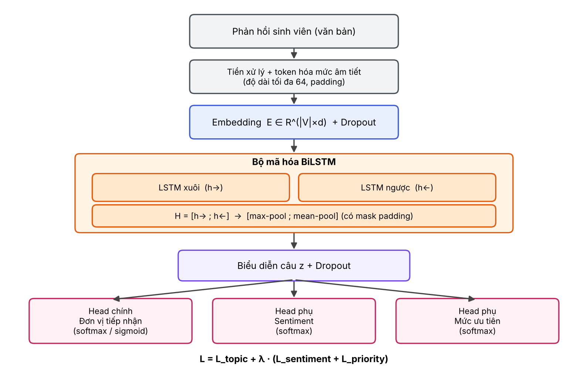

# 1. Introduction

## 1.1. Bối cảnh và động lực

Phản hồi của sinh viên là một nguồn thông tin quan trọng để nhà trường đánh giá và cải thiện chất lượng đào tạo. Mỗi học kỳ, các trường đại học thu thập hàng nghìn ý kiến qua phiếu khảo sát, cổng thông tin, email và các kênh mạng xã hội, trải rộng trên nhiều mảng: chương trình đào tạo, giảng viên, cơ sở vật chất, học phí, thủ tục hành chính, hệ thống công nghệ thông tin, thư viện và dịch vụ sinh viên. Trong thực tế, việc đọc, phân loại và chuyển từng phản hồi đến đúng đơn vị phụ trách vẫn chủ yếu được làm thủ công. Cách làm này chậm, phụ thuộc vào người xử lý, và dễ bỏ sót những phản hồi cần xử lý gấp, chẳng hạn khiếu nại về lỗi hệ thống đăng ký môn học vào đúng đợt đăng ký hoặc về điều kiện an toàn tại cơ sở vật chất.

Phân loại văn bản tự động là hướng tiếp cận tự nhiên cho bài toán này. Với tiếng Việt, bộ dữ liệu UIT-VSFC [1] gồm hơn 16.000 câu phản hồi của sinh viên được gán nhãn chủ đề và cảm xúc đã trở thành chuẩn tham chiếu, và nhiều nghiên cứu đã so sánh các bộ phân loại truyền thống với mạng nơ-ron trên bộ dữ liệu này [2, 10, 11]. Bên cạnh các mô hình ngôn ngữ tiền huấn luyện như PhoBERT [3], các mô hình học sâu nhẹ như BiLSTM [5, 6] và TextCNN [4] vẫn được quan tâm vì chi phí huấn luyện thấp, tốc độ suy luận nhanh và dễ triển khai trên máy chủ không có GPU. Đó là những điều kiện thường gặp ở một hệ thống dashboard nội bộ của nhà trường.

## 1.2. Khoảng trống nghiên cứu

Từ khảo sát tài liệu và yêu cầu của bài toán, nhóm xác định bốn khoảng trống chính.

1. **Bài toán định tuyến khác bài toán phân loại chủ đề.** Phần lớn nghiên cứu trên dữ liệu phản hồi sinh viên dừng ở phân loại cảm xúc hoặc một số ít chủ đề (giảng viên, chương trình đào tạo, cơ sở vật chất, khác) [1, 9]. Hệ thống thực tế cần xác định *đơn vị tiếp nhận* với số lớp nhiều hơn, đồng thời cần mức độ ưu tiên để sắp xếp thứ tự xử lý.
2. **Một phản hồi có thể thuộc nhiều đơn vị.** Ví dụ "Wifi ở thư viện rất yếu" liên quan đến cả hệ thống công nghệ thông tin lẫn thư viện. Cách đặt bài toán multiclass buộc mô hình chỉ chọn một nhãn, nên làm mất thông tin và có thể chuyển phản hồi đến sai nơi. Cách đặt multilabel ít được so sánh trực tiếp với multiclass trên cùng một pipeline.
3. **Mất cân bằng lớp ảnh hưởng đến đúng các lớp quan trọng.** Dữ liệu phản hồi thường lệch rõ rệt: một vài chủ đề chiếm đa số, còn phản hồi khẩn cấp hoặc tiêu cực nặng chỉ chiếm tỷ lệ nhỏ. Độ chính xác (accuracy) và các độ đo gộp theo mẫu có thể trông tốt trong khi recall của lớp khẩn cấp thấp. Tác động của các kỹ thuật xử lý mất cân bằng (trọng số lớp, focal loss) lên Macro-F1 và lên recall của lớp khẩn cấp cần được đo một cách có hệ thống.
4. **Thiếu so sánh về chi phí giữa mô hình học sâu nhẹ và các lựa chọn khác.** Các mô hình tiền huấn luyện thường cho kết quả tốt nhưng đòi hỏi nhiều tài nguyên hơn. Với hệ thống cần phản hồi theo thời gian thực trên phần cứng hạn chế, câu hỏi thực tế là một mô hình nhẹ như BiLSTM có đạt được mức cân bằng tốt hơn giữa Macro-F1 và độ trễ so với baseline TF-IDF cùng bộ phân loại tuyến tính hay không.

## 1.3. Đóng góp của đồ án

Đồ án xây dựng hệ thống phân loại và định tuyến phản hồi sinh viên bằng tiếng Việt, với các đóng góp sau:

1. **Pipeline học sâu thống nhất cho hai cách đặt bài toán.** Một cài đặt duy nhất hỗ trợ cả multiclass và multilabel cho đơn vị tiếp nhận, dùng bộ mã hóa văn bản BiLSTM, nên hai cách đặt bài toán được so sánh trên cùng dữ liệu, cùng cách chia tập và cùng tiêu chí đánh giá.
2. **Học đa tác vụ (multi-task learning).** Mô hình dự đoán đồng thời đơn vị tiếp nhận, cảm xúc và mức độ ưu tiên (thấp, trung bình, cao) từ một biểu diễn câu dùng chung, nhằm tận dụng tín hiệu cảm xúc cho việc nhận diện phản hồi khẩn cấp.
3. **Xử lý mất cân bằng lớp và đánh giá tác động.** Nhóm triển khai ba cấu hình hàm mất mát (cross-entropy chuẩn, có trọng số lớp, focal loss [7]) và đánh giá chúng bằng Macro-F1 cùng precision, recall của lớp khẩn cấp.
4. **Quy trình điều chỉnh hyperparameter có thể tái lập.** Tìm kiếm hyperparameter ngẫu nhiên trên một lưới cho trước (8 cấu hình), chọn theo Macro-F1 trên tập validation, cố định seed, dừng sớm, và ghi lại cấu hình, thời gian huấn luyện, độ trễ suy luận cho từng thử nghiệm.
5. **Phân tích so sánh và lỗi.** Kết quả của BiLSTM được so với baseline TF-IDF kết hợp Logistic Regression hoặc Linear SVM và với mô hình tiền huấn luyện, kèm phân tích lỗi cho phản hồi nhiều đơn vị, phản hồi quá ngắn và các phản hồi quan trọng bị phân loại sai.

## 1.4. Cấu trúc bài báo

Phần 2 tổng quan các nghiên cứu liên quan. Phần 3 trình bày phương pháp, trong đó có kiến trúc học sâu. Phần 4 mô tả dữ liệu và thiết lập thực nghiệm. Phần 5 trình bày kết quả và thảo luận. Phần 6 phân tích lỗi và hạn chế. Phần 7 kết luận.

# 3. Methodology

## 3.2. Kiến trúc học sâu

### 3.2.1. Tổng quan

Mô hình cải tiến thứ nhất gồm một bộ mã hóa văn bản dùng chung giữa các tác vụ, là BiLSTM hai chiều, và các đầu ra tuyến tính cho từng tác vụ. Hình 1 minh họa toàn bộ kiến trúc. Văn bản đầu vào được chuẩn hóa chữ thường, tách theo âm tiết (tiếng Việt tách theo dấu cách) và chuyển thành chuỗi chỉ số từ điển, cắt hoặc đệm về độ dài cố định $T = 64$. Từ điển $V$ chỉ giữ các âm tiết xuất hiện ít nhất hai lần trong tập huấn luyện, các âm tiết còn lại được ánh xạ về ký hiệu `<unk>`. Từ điển được xây chỉ từ tập huấn luyện để tránh rò rỉ dữ liệu.

{width=15.5cm}

::: {custom-style="Caption"}
Hình 1. Kiến trúc mô hình học sâu: bộ mã hóa BiLSTM dùng chung, kèm ba đầu ra (đơn vị tiếp nhận, cảm xúc, mức ưu tiên).
:::

Một chuỗi $x = (x_1, \dots, x_T)$ được ánh xạ qua ma trận embedding $E \in \mathbb{R}^{|V| \times d}$ thành $e_t = E[x_t]$, sau đó áp dụng dropout. Ký hiệu $m_t \in \{0,1\}$ là mặt nạ đánh dấu vị trí không phải padding.

### 3.2.2. Bộ mã hóa BiLSTM

LSTM [5] duy trì một trạng thái ô nhớ $c_t$ được điều khiển bởi ba cổng, giúp học các phụ thuộc xa trong câu:

$$i_t = \sigma(W_i e_t + U_i h_{t-1} + b_i), \quad f_t = \sigma(W_f e_t + U_f h_{t-1} + b_f), \quad o_t = \sigma(W_o e_t + U_o h_{t-1} + b_o) \qquad (1)$$

$$\tilde{c}_t = \tanh(W_c e_t + U_c h_{t-1} + b_c), \quad c_t = f_t \odot c_{t-1} + i_t \odot \tilde{c}_t, \quad h_t = o_t \odot \tanh(c_t) \qquad (2)$$

Trong đó $\sigma$ là hàm sigmoid, $\odot$ là tích từng phần tử. BiLSTM [6] chạy hai LSTM theo hai chiều và nối trạng thái ẩn tại mỗi vị trí, $h_t = [\overrightarrow{h_t}; \overleftarrow{h_t}] \in \mathbb{R}^{2H}$, nên mỗi âm tiết được biểu diễn với ngữ cảnh cả bên trái lẫn bên phải. Điều này quan trọng với tiếng Việt, nơi nghĩa của một âm tiết phụ thuộc nhiều vào âm tiết đứng cạnh (ví dụ "học" trong "học phí" và "học bổng").

Biểu diễn câu được tổng hợp bằng cách nối max-pooling và mean-pooling theo thời gian, chỉ tính trên các vị trí không phải padding:

$$z = \Big[\, \max_{t:\, m_t = 1} h_t \;;\; \frac{\sum_t m_t h_t}{\sum_t m_t} \,\Big] \in \mathbb{R}^{4H} \qquad (3)$$

Max-pooling giữ lại các tín hiệu mạnh cục bộ (một từ khóa như "wifi", "học phí"), còn mean-pooling nắm bắt sắc thái chung của câu.

### 3.2.3. Các đầu ra và biểu diễn nhãn

Sau khi áp dụng dropout lên $z$, mỗi tác vụ có một lớp tuyến tính riêng: $o^{(\tau)} = W^{(\tau)} z + b^{(\tau)}$.

- **Đơn vị tiếp nhận, multiclass:** có $K$ lớp, xác suất $p = \mathrm{softmax}(o^{\text{topic}})$ và dự đoán là $\arg\max_k p_k$.
- **Đơn vị tiếp nhận, multilabel:** mỗi lớp là một bài toán nhị phân độc lập, $p_k = \sigma(o^{\text{topic}}_k)$, và nhãn $k$ được gán khi $p_k > \theta$. Ngưỡng toàn cục $\theta \in [0{,}2;\ 0{,}7]$ được chọn trên tập validation để tối đa hóa Macro-F1.
- **Cảm xúc và mức ưu tiên:** đầu ra softmax ba lớp (cảm xúc) và ba lớp thấp, trung bình, cao (mức ưu tiên). Các mẫu thiếu nhãn phụ bị bỏ qua trong phần mất mát tương ứng.

### 3.2.4. Hàm mất mát và xử lý mất cân bằng lớp

Với tập huấn luyện gồm $N$ mẫu, gọi $n_k$ là số mẫu của lớp $k$. Trọng số lớp tỷ lệ nghịch với tần suất, chuẩn hóa để trung bình bằng 1:

$$\alpha_k = \frac{N}{K\, n_k} \qquad (4)$$

Nhóm triển khai ba cấu hình cho tác vụ multiclass, với $y$ là nhãn đúng và $p_y$ là xác suất mô hình gán cho nhãn đó:

$$\mathcal{L}_{\mathrm{CE}} = -\log p_y, \qquad \mathcal{L}_{\mathrm{WCE}} = -\alpha_y \log p_y \qquad (5)$$

$$\mathcal{L}_{\mathrm{focal}} = -\alpha_y\, (1 - p_y)^{\gamma} \log p_y, \quad \gamma = 2 \qquad (6)$$

Focal loss [7] giảm đóng góp của các mẫu đã được phân loại đúng với độ tin cậy cao (khi $p_y \to 1$ thì $(1-p_y)^\gamma \to 0$), nhờ đó gradient tập trung vào các mẫu khó và các lớp hiếm.

Với multilabel, mất mát là binary cross-entropy có trọng số dương cho từng lớp, $\beta_k = (N - n_k^+)/n_k^+$ với $n_k^+$ là số mẫu dương của lớp $k$:

$$\mathcal{L}_{\mathrm{BCE}} = -\frac{1}{K} \sum_{k=1}^{K} \Big[ \beta_k\, y_k \log p_k + (1 - y_k) \log (1 - p_k) \Big] \qquad (7)$$

Phiên bản focal cho multilabel nhân thêm hệ số $(1 - p_t)^{\gamma}$ cho từng phần tử, trong đó $p_t = p_k$ nếu $y_k = 1$ và $p_t = 1 - p_k$ trong trường hợp còn lại.

Hàm mục tiêu cuối cùng của học đa tác vụ [8] là tổng có trọng số:

$$\mathcal{L} = \mathcal{L}_{\mathrm{topic}} + \lambda \big( \mathcal{L}_{\mathrm{sentiment}} + \mathcal{L}_{\mathrm{priority}} \big), \quad \lambda = 0{,}5 \qquad (8)$$

Chọn $\lambda < 1$ giữ cho tác vụ chính (định tuyến) là mục tiêu ưu tiên, trong khi hai tác vụ phụ đóng vai trò điều hòa biểu diễn dùng chung.

### 3.2.5. Thuật toán huấn luyện

::: {custom-style="Caption"}
Thuật toán 1. Huấn luyện và chọn mô hình với tìm kiếm hyperparameter ngẫu nhiên trên lưới.
:::

| |
|:-------------------------------------------------------------------------------------------|
| **Đầu vào:** tập train/val/test đã khử trùng lặp; lưới siêu tham số, từ đó lấy ngẫu nhiên $n = 8$ cấu hình tạo thành $\mathcal{G}$; số epoch tối đa $E$; độ kiên nhẫn $P$ |
| **Đầu ra:** mô hình tốt nhất $f^*$, ngưỡng $\theta^*$, kết quả trên tập test và tập OOD |
| 1. Xây từ điển $V$ chỉ từ tập train; mã hóa các tập thành chuỗi chỉ số độ dài $T$ |
| 2. Tính trọng số lớp $\alpha_k$ (và $\beta_k$ nếu multilabel) từ tập train |
| 3. **Với mỗi** cấu hình $g \in \mathcal{G}$ (embedding, kích thước ẩn, dropout, learning rate): |
| 4. $\quad$ Đặt seed, khởi tạo mô hình BiLSTM và bộ tối ưu AdamW [12] |
| 5. $\quad$ **Với mỗi** epoch: duyệt các mini-batch đã xáo trộn, tính $\mathcal{L}$ theo (8), lan truyền ngược, cắt gradient theo chuẩn 5 [13], cập nhật tham số |
| 6. $\quad$ $\quad$ Tính Macro-F1 trên tập val (multilabel: chọn $\theta$ tối ưu trên val) |
| 7. $\quad$ $\quad$ Nếu Macro-F1 tăng thì lưu trọng số tốt nhất; ngược lại tăng bộ đếm. Dừng nếu bộ đếm đạt $P$ |
| 8. $\quad$ Ghi lại Macro-F1 trên val, thời gian huấn luyện của cấu hình $g$ |
| 9. Chọn cấu hình có Macro-F1 trên val cao nhất, nạp lại trọng số tốt nhất của nó |
| 10. Đánh giá **một lần** trên tập test và tập ngoài phân phối (OOD): Macro-F1, Micro-F1, weighted-F1, confusion matrix, precision/recall lớp khẩn cấp, độ trễ trung bình trên từng mẫu |

### 3.2.6. Cấu hình và các quyết định thiết kế

::: {custom-style="Caption"}
Bảng 1. Cấu hình mặc định và lưới hyperparameter của mô hình học sâu (lưới 16 cấu hình, mỗi lần huấn luyện thử 8 cấu hình lấy ngẫu nhiên).
:::

| Thành phần | Giá trị mặc định | Lưới tìm kiếm |
|:--------------------|:-----------------|:-----------------------|
| Kích thước embedding $d$ | 128 | {100, 200} |
| Kích thước ẩn $H$ | 128 | {64, 128} |
| Dropout | 0,4 | {0,3; 0,5} |
| Learning rate (AdamW, weight decay 0,01) | $2 \times 10^{-3}$ | {$10^{-3}$, $3 \times 10^{-3}$} |
| Batch size; độ dài chuỗi $T$ | 32; 64 | cố định |
| Số epoch tối đa; độ kiên nhẫn $P$ | 12; 3 | cố định |
| Trọng số tác vụ phụ $\lambda$; focal $\gamma$ | 0,5; 2 | cố định |
| Seed | 42 | cố định |

Một số quyết định thiết kế đáng chú ý. Thứ nhất, nhóm dùng embedding khởi tạo ngẫu nhiên và huấn luyện từ đầu để mô hình nhẹ, không phụ thuộc tài nguyên ngoài, đồng thời tạo mức tham chiếu rõ ràng giữa mô hình huấn luyện từ đầu và mô hình tiền huấn luyện như PhoBERT [3]. Thứ hai, việc chọn mô hình dựa trên Macro-F1 trên tập validation thay vì accuracy, vì Macro-F1 cho mọi lớp trọng số như nhau và phản ánh đúng mục tiêu nhận diện được cả các lớp hiếm. Thứ ba, ngưỡng của multilabel được chọn trên validation chứ không phải trên test, để tránh ước lượng lạc quan. Thứ tư, dùng cả max-pooling và mean-pooling vì max-pooling nhạy với từ khóa còn mean-pooling ổn định với các câu dài. Cuối cùng, các tác vụ phụ chia sẻ biểu diễn với tác vụ chính nên chi phí suy luận tăng không đáng kể, vì chỉ thêm hai lớp tuyến tính nhỏ.

# Tài liệu tham khảo (các mục dùng trong hai phần trên)

[1] K. V. Nguyen, V. D. Nguyen, P. X.-V. Nguyen, T. T.-H. Truong, N. L.-T. Nguyen, "UIT-VSFC: Vietnamese Students' Feedback Corpus for Sentiment Analysis," in *Proc. 10th Int. Conf. Knowledge and Systems Engineering (KSE)*, Ho Chi Minh City, 2018.

[2] P. X.-V. Nguyen, T. T.-H. Truong, K. V. Nguyen, N. L.-T. Nguyen, "Deep learning versus traditional classifiers on Vietnamese students' feedback corpus," in *Proc. 5th NAFOSTED Conf. Information and Computer Science (NICS)*, 2018, pp. 75–80.

[3] D. Q. Nguyen, A. T. Nguyen, "PhoBERT: Pre-trained language models for Vietnamese," in *Findings of the Association for Computational Linguistics: EMNLP 2020*, 2020, pp. 1037–1042.

[4] Y. Kim, "Convolutional neural networks for sentence classification," in *Proc. EMNLP*, 2014, pp. 1746–1751.

[5] S. Hochreiter, J. Schmidhuber, "Long short-term memory," *Neural Computation*, vol. 9, no. 8, pp. 1735–1780, 1997.

[6] M. Schuster, K. K. Paliwal, "Bidirectional recurrent neural networks," *IEEE Trans. Signal Processing*, vol. 45, no. 11, pp. 2673–2681, 1997.

[7] T.-Y. Lin, P. Goyal, R. Girshick, K. He, P. Dollár, "Focal loss for dense object detection," in *Proc. IEEE ICCV*, 2017, pp. 2980–2988.

[8] R. Caruana, "Multitask learning," *Machine Learning*, vol. 28, pp. 41–75, 1997.

[9] Z. Kastrati, F. Dalipi, A. S. Imran, K. Pireva Nuci, M. A. Wani, "Sentiment analysis of students' feedback with NLP and deep learning: A systematic mapping study," *Applied Sciences*, vol. 11, no. 9, art. 3986, 2021.

[10] L. S. Le, D. V. Thin, N. L.-T. Nguyen, S. Q. Trinh, "A multi-filter BiLSTM-CNN architecture for Vietnamese sentiment analysis," in *Int. Conf. Computational Collective Intelligence (ICCCI)*, Springer, 2020, pp. 752–763.

[11] V. D. Nguyen, K. V. Nguyen, N. L.-T. Nguyen, "Variants of long short-term memory for sentiment analysis on Vietnamese students' feedback corpus," in *Proc. 10th Int. Conf. KSE*, 2018, pp. 306–311.

[12] I. Loshchilov, F. Hutter, "Decoupled weight decay regularization," in *Proc. ICLR*, 2019.

[13] R. Pascanu, T. Mikolov, Y. Bengio, "On the difficulty of training recurrent neural networks," in *Proc. ICML*, 2013, pp. 1310–1318.
